# Dokumentasi Grafik Hasil Penelitian ReturnWise

## Cakupan dan cara ekstraksi

Seluruh 21 notebook bernomor 00–20 diperiksa, termasuk markdown, source code, output teks/tabel, output gambar, dan pesan error. Ditemukan 29 output gambar PNG yang benar-benar tertanam di notebook. Semua 29 gambar diekstrak sebagai salinan byte PNG asli tanpa re-encoding atau perubahan isi grafik. Tidak ada output Plotly yang tertanam dan tidak ada gambar notebook yang gagal diekstrak.

Penomoran Gambar 1–29 mengikuti urutan notebook dan output gambar. Setiap catatan mengidentifikasi sumber notebook, isi grafik, pola yang terlihat, relevansi, dan batas interpretasi. Sebagian grafik model berasal dari output eksperimen historis yang mendahului pipeline raw-feature terkoreksi; grafik tersebut tetap dipertahankan sebagai bukti output notebook dan tidak menggantikan tabel hasil terkoreksi.

Notebook 02 dan 03 tidak memiliki PNG grafik tersimpan. Notebook 11 memiliki source plotting trial Optuna, tetapi tidak memiliki output gambar tertanam sehingga tidak ada grafik yang dapat diekstrak dari notebook itu. Notebook 14 menyimpan satu grafik permutation importance; tidak ada gambar output SHAP. Tidak ditemukan gambar confusion matrix, ROC curve, atau precision-recall curve dalam output notebook, walaupun metrik dan tabel evaluasi tertentu tersedia.

Empat PNG tambahan terdapat di reports/figures/ sebagai aset analisis dataset pada laporan terpisah. File tersebut bukan output gambar notebook, sehingga tidak dimasukkan ke penomoran dokumen ini.

## 1. Data Understanding

### Gambar 1. Pemeriksaan Dependensi Environment ReturnWise

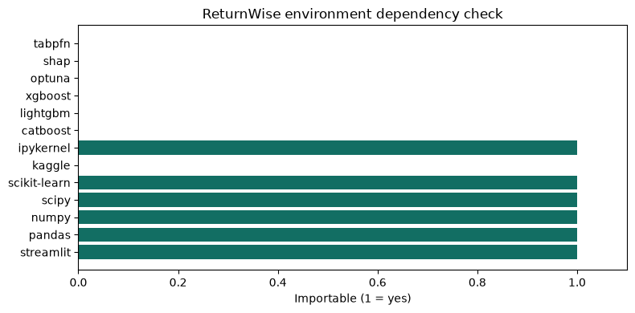

**Sumber:** notebooks/00_environment_setup.ipynb.  
**Deskripsi:** Grafik batang horizontal menunjukkan apakah dependensi pada saat notebook dijalankan dapat diimpor. Streamlit, pandas, NumPy, SciPy, scikit-learn, dan ipykernel ditandai tersedia; sejumlah paket opsional, termasuk LightGBM dan Optuna, ditandai belum tersedia pada snapshot tersebut.  
**Interpretasi:** Grafik mendokumentasikan environment saat eksekusi awal, bukan environment akhir. Laporan eksperimen kemudian mencatat LightGBM dan Optuna terpasang.  
**Relevansi:** Membantu menafsirkan mengapa benchmark awal tidak mencakup beberapa keluarga model.

### Gambar 2. Ukuran Berkas Dataset Kompetisi

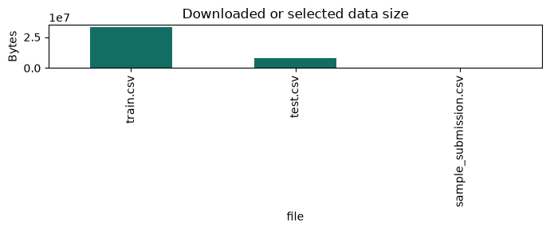

**Sumber:** notebooks/01_kaggle_dataset_acquisition.ipynb.  
**Deskripsi:** Batang membandingkan ukuran byte train.csv, test.csv, dan sample_submission.csv pada cache lokal.  
**Interpretasi:** train.csv adalah berkas terbesar, disusul test.csv dan template submission. Grafik ini tidak menunjukkan jumlah baris; jumlah observasi diperiksa dari isi CSV.  
**Relevansi:** Memberi konteks ukuran sumber data dan beban pemrosesan.

### Gambar 3. Distribusi Target returned

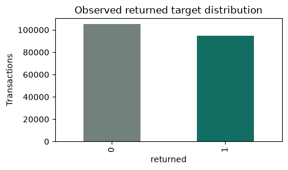

**Sumber:** notebooks/04_exploratory_data_analysis.ipynb.  
**Deskripsi:** Diagram batang jumlah transaksi untuk kelas returned=0 dan returned=1.  
**Interpretasi:** Kelas tidak retur berjumlah 105.081 dan kelas retur 94.919; distribusi relatif berimbang dengan prevalence retur 47,4595%.  
**Relevansi:** Menjadi konteks bagi pembagian stratified dan pembacaan ROC-AUC/PR-AUC. Distribusi ini tidak menunjukkan penyebab retur.

## 2. Data Quality Analysis

Tidak ada gambar PNG data-quality yang tertanam pada output notebooks/03_data_quality_assessment.ipynb. Notebook tersebut menyimpan tabel pemeriksaan, termasuk ringkasan missingness; karena berkas tidak memiliki missing cell, source plotting tidak menghasilkan output gambar tersimpan. Anomali rentang dan jumlah barisnya didokumentasikan pada KTI.md dan laporan kualitas data internal.

## 3. Exploratory Data Analysis

### Gambar 4. Usia Pelanggan Menurut Status Retur

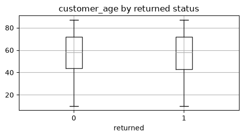

**Sumber:** notebooks/04_exploratory_data_analysis.ipynb.  
**Deskripsi:** Boxplot customer_age untuk returned=0 dan returned=1.  
**Interpretasi:** Median dan rentang antarkelompok tampak banyak tumpang tindih. Grafik tidak menunjukkan pemisahan sederhana yang kuat hanya dari usia.  
**Relevansi:** Menunjukkan perlunya menilai fitur dalam model multivariat; boxplot tidak mengukur performa prediksi.

### Gambar 5. Harga Produk Menurut Status Retur

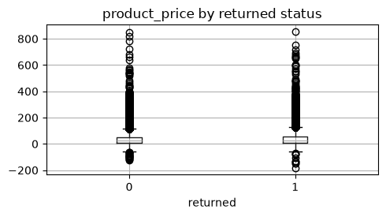

**Sumber:** notebooks/04_exploratory_data_analysis.ipynb.  
**Deskripsi:** Boxplot product_price menurut target.  
**Interpretasi:** Kedua kelompok memiliki sebaran pusat yang bertumpang tindih dan banyak titik ekstrem. Skala grafik menampilkan pula nilai di bawah nol yang perlu ditafsirkan bersama audit kualitas.  
**Relevansi:** Memperlihatkan mengapa ringkasan median dan anomali nilai perlu dibaca bersama.

### Gambar 6. Persentase Diskon Menurut Status Retur

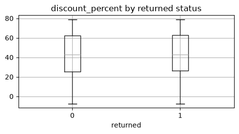

**Sumber:** notebooks/04_exploratory_data_analysis.ipynb.  
**Deskripsi:** Boxplot discount_percent untuk dua kelas target.  
**Interpretasi:** Sebaran pusat dan rentang utama kedua kelas tampak serupa. Plot ini tidak meniadakan nilai diskon di luar rentang lazim yang terdeteksi melalui pemeriksaan tabel.  
**Relevansi:** Menjadi pemeriksaan deskriptif, bukan dasar untuk clipping atau aturan diskon.

### Gambar 7. Rating Produk Menurut Status Retur

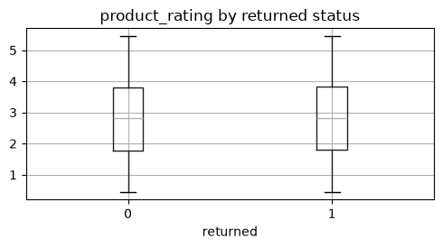

**Sumber:** notebooks/04_exploratory_data_analysis.ipynb.  
**Deskripsi:** Boxplot product_rating menurut returned.  
**Interpretasi:** Distribusi kedua kelas banyak bertumpang tindih. Grafik tidak menunjukkan kapan rating direkam; risiko snapshot sesudah transaksi tetap ada.  
**Relevansi:** Menghubungkan EDA dengan catatan feature availability product_rating.

### Gambar 8. Proporsi Retur Menurut Jenis Perangkat

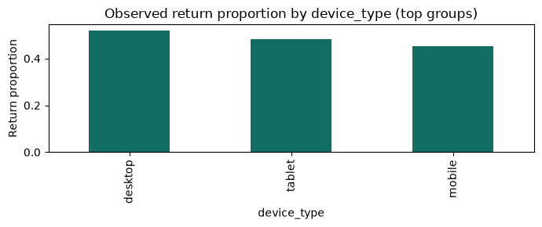

**Sumber:** notebooks/04_exploratory_data_analysis.ipynb.  
**Deskripsi:** Return proportion ditampilkan untuk desktop, tablet, dan mobile.  
**Interpretasi:** Desktop memiliki proporsi mentah tertinggi dan mobile terendah pada berkas ini. Laporan dataset mencatat masing-masing 51,91%, 48,38%, dan 45,12%.  
**Relevansi:** Menunjukkan variasi antarkategori yang dapat dievaluasi model; tidak membuktikan perangkat menyebabkan retur.

### Gambar 9. Proporsi Retur Menurut Kategori Produk

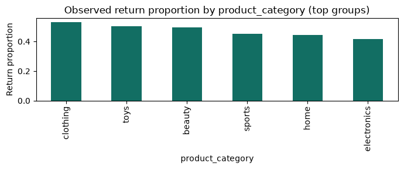

**Sumber:** notebooks/04_exploratory_data_analysis.ipynb.  
**Deskripsi:** Proporsi retur mentah untuk enam kategori produk.  
**Interpretasi:** Clothing dan toys berada di bagian atas grafik; electronics berada di bagian bawah. Laporan mencatat rentang 41,73% untuk electronics hingga 53,05% untuk clothing.  
**Relevansi:** Mendukung pemeriksaan kelompok pada EDA, tetapi bukan aturan intervensi kategori.

### Gambar 10. Proporsi Retur Menurut Metode Pengiriman

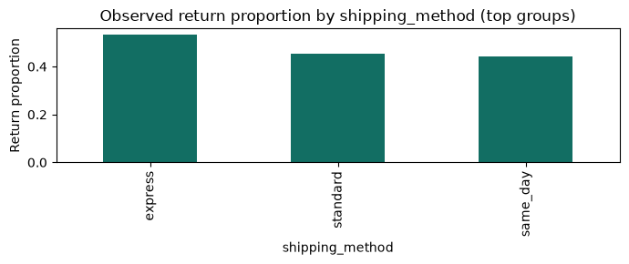

**Sumber:** notebooks/04_exploratory_data_analysis.ipynb.  
**Deskripsi:** Return proportion ditampilkan untuk express, standard, dan same day.  
**Interpretasi:** Express tampak tertinggi dan same day terendah pada data ini; laporan mencatat 53,22% dan 44,29%.  
**Relevansi:** Memperlihatkan pola mentah; pilihan pengiriman dapat berkaitan dengan variabel lain dan tidak dapat dianggap penyebab.

### Gambar 11. Proporsi Retur Menurut Metode Pembayaran

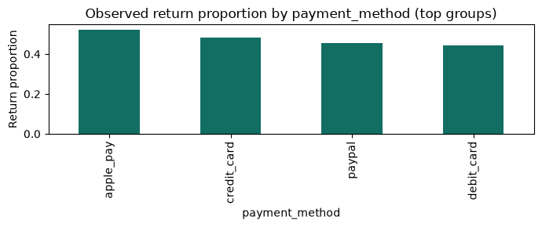

**Sumber:** notebooks/04_exploratory_data_analysis.ipynb.  
**Deskripsi:** Return proportion ditampilkan untuk Apple Pay, credit card, PayPal, dan debit card.  
**Interpretasi:** Apple Pay tampak tertinggi dan debit card terendah; laporan mencatat 52,17% dan 44,18%.  
**Relevansi:** Menunjukkan variasi antarkelompok yang layak diperiksa dalam validasi, bukan dasar menyarankan metode pembayaran.

### Gambar 12. Ukuran Efek Asosiasi Fitur

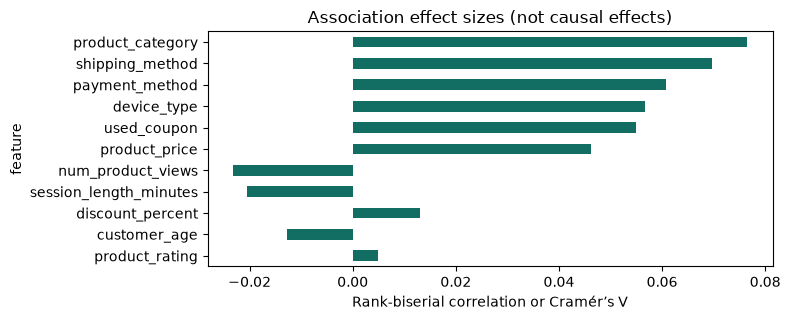

**Sumber:** notebooks/05_statistical_analysis.ipynb.  
**Deskripsi:** Bar horizontal menampilkan association effect size; sumbu menyebut rank-biserial correlation atau Cramér’s V.  
**Interpretasi:** Beberapa fitur kategori seperti product_category dan shipping_method menampilkan asosiasi relatif besar pada plot; beberapa ukuran bernilai negatif karena ukuran rank-biserial. Ukuran yang dipakai tidak identik antarjenis fitur.  
**Relevansi:** Membantu memprioritaskan pemeriksaan statistik, tetapi ukuran campuran pada satu sumbu tidak boleh ditafsirkan sebagai ranking sebab-akibat.

### Gambar 13. Korelasi Spearman Antar-Prediktor Numerik

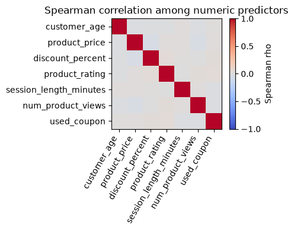

**Sumber:** notebooks/05_statistical_analysis.ipynb.  
**Deskripsi:** Heatmap korelasi Spearman fitur numerik yang dipilih; target tidak ditampilkan pada matriks ini.  
**Interpretasi:** Di luar diagonal, warna relatif dekat ke nol pada sebagian besar pasangan sehingga hubungan monotonic antar-prediktor yang diplot tampak lemah.  
**Relevansi:** Memberi gambaran redundansi fitur. Matriks ini bukan bukti bahwa fitur tidak berkaitan dengan label.

### Gambar 14. P-Value Terkecil Setelah Koreksi Benjamini–Hochberg

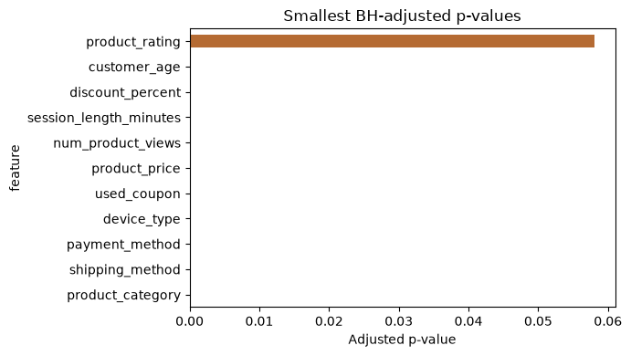

**Sumber:** notebooks/06_problem_identification.ipynb.  
**Deskripsi:** Bar horizontal memperlihatkan hingga 15 p-value terkoreksi BH terkecil dari uji asosiasi yang tersimpan.  
**Interpretasi:** product_rating tampak memiliki adjusted p-value paling tinggi di antara bar yang diplot, sedangkan nilai lainnya berada dekat nol pada skala gambar. Status signifikansi tetap merujuk ke tabel dan ambang yang ditentukan, bukan penampilan semata.  
**Relevansi:** Menjelaskan koreksi pengujian berganda; p-value kecil tidak menunjukkan besar efek atau kausalitas.

## 4. Preprocessing Analysis

### Gambar 15. Ukuran Split Pengembangan dan Holdout Internal

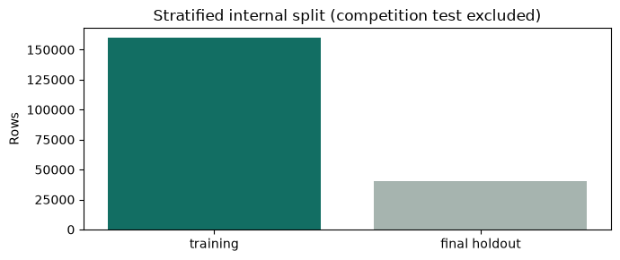

**Sumber:** notebooks/07_data_preprocessing.ipynb.  
**Deskripsi:** Diagram batang membandingkan 160.000 baris training/development dengan 40.000 baris final holdout. Test kompetisi dikecualikan.  
**Interpretasi:** Rasio split adalah 80:20 pada dataset train berlabel. Grafik tidak menggambarkan split tiga fold yang digunakan dalam corrected CV.  
**Relevansi:** Menjelaskan pembagian historis dan mencegah test tanpa label dianggap data evaluasi.

## 5. Feature Engineering

### Gambar 16. Distribusi Interaksi Harga dan Diskon

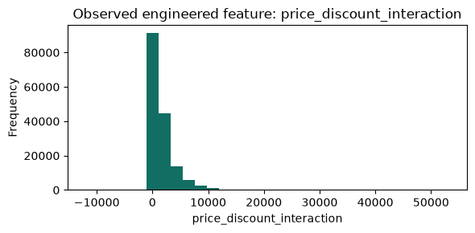

**Sumber:** notebooks/08_feature_engineering.ipynb.  
**Deskripsi:** Histogram fitur product_price × discount_percent.  
**Interpretasi:** Sebagian besar nilai terkumpul di sisi kiri rentang dan terdapat ekor kanan panjang; sebagian nilai negatif mengikuti input harga/diskon.  
**Relevansi:** Memperlihatkan bahwa interaksi mewarisi skala dan anomali sumber; histogram tidak membuktikan peningkatan model.

### Gambar 17. Distribusi Tampilan Produk per Menit Sesi

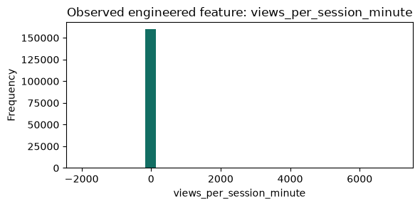

**Sumber:** notebooks/08_feature_engineering.ipynb.  
**Deskripsi:** Histogram num_product_views dibagi session_length_minutes.  
**Interpretasi:** Histogram sangat terkonsentrasi dekat nol dan memiliki rentang ekor yang lebar, termasuk nilai ekstrem. Rasio sensitif terhadap denominator sesi kecil/negatif.  
**Relevansi:** Menjelaskan risiko numerik dari interaksi ini dan alasan tidak menganggap rasio sebagai peningkatan otomatis.

### Gambar 18. Distribusi Interaksi Harga dan Rating

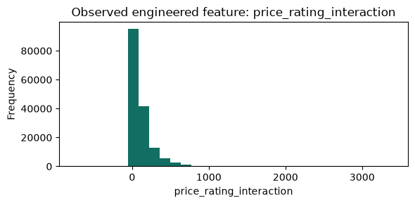

**Sumber:** notebooks/08_feature_engineering.ipynb.  
**Deskripsi:** Histogram product_price × product_rating.  
**Interpretasi:** Sebagian besar nilai berada pada rentang rendah dengan ekor kanan dan nilai negatif dari input harga.  
**Relevansi:** Menggambarkan skala fitur turunan yang dibandingkan di CV; tidak menyatakan hubungan kausal.

## 6. Feature Selection

Tidak ada grafik feature-selection yang tertanam pada output notebook. Hasil L1 selection dicatat sebagai tabel metrik pada laporan feature_selection_analysis.md dan KTI.md.

## 7. Model Comparison

### Gambar 19. Metrik Cross-Validation Baseline Awal

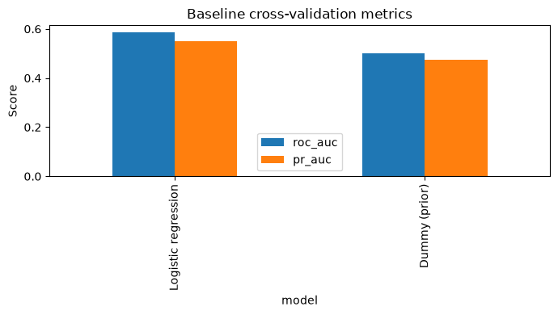

**Sumber:** notebooks/09_baseline_machine_learning.ipynb.  
**Deskripsi:** Diagram batang ROC-AUC dan PR-AUC untuk Logistic Regression dan Dummy prior.  
**Interpretasi:** Logistic Regression berada di atas prior konstan pada metrik ranking yang ditampilkan.  
**Relevansi:** Menjadi pembanding awal apakah model menggunakan pola fitur. Ini output benchmark historis dan bukan tabel final corrected candidates.

### Gambar 20. ROC-AUC Benchmark Model Lanjutan

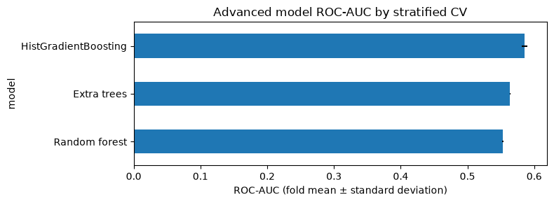

**Sumber:** notebooks/10_advanced_model_benchmarking.ipynb.  
**Deskripsi:** Bar horizontal mean ROC-AUC dan simpangan baku fold untuk model yang selesai pada benchmark tersimpan.  
**Interpretasi:** HistGradientBoosting berada di atas Extra Trees dan Random Forest pada output ini. Error bars menunjukkan variasi fold sebagaimana tersimpan.  
**Relevansi:** Memperlihatkan hasil model quick benchmark saat notebook dijalankan. Grafik tidak mencakup seluruh model pada corrected raw comparison dan tidak boleh dipakai sebagai hasil LightGBM terkini.

### Gambar 21. Kandidat Tunggal dan Blend OOF yang Tersimpan

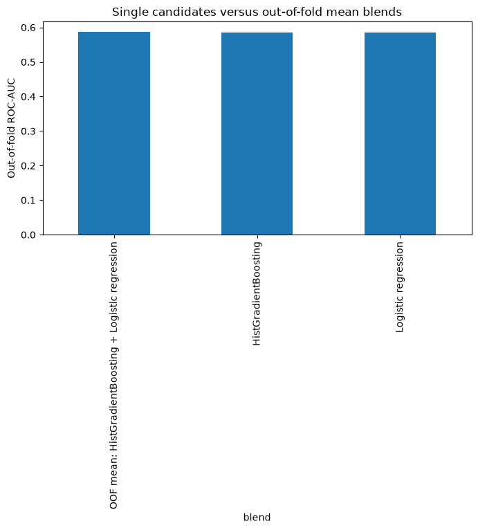

**Sumber:** notebooks/12_ensemble_experiments.ipynb.  
**Deskripsi:** Diagram batang ROC-AUC OOF untuk kandidat tunggal dan mean blend yang disimpan oleh notebook.  
**Interpretasi:** Bar berada pada rentang yang berdekatan; blend yang ditampilkan hanya sedikit di atas kandidat tunggal pada output tersebut.  
**Relevansi:** Memotivasi pemeriksaan ensemble tetapi tidak membuktikan gain stabil. Hasil corrected OOF yang lebih baru dirangkum terpisah dalam KTI.md; grafik notebook ini tidak menggantikannya.

## 8. Model Evaluation

### Gambar 29. Ringkasan Metrik Holdout Internal Historis

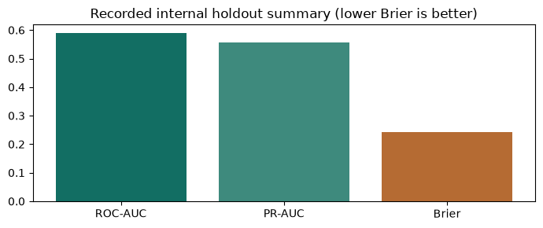

**Sumber:** notebooks/20_returnwise_model_export.ipynb.  
**Deskripsi:** Diagram menampilkan ROC-AUC, PR-AUC, dan Brier untuk evaluasi holdout model yang diekspor.  
**Interpretasi:** Nilai tersimpan sekitar ROC-AUC 0,5895, PR-AUC 0,5561, dan Brier 0,2431. Brier memiliki arah lebih baik yang lebih rendah, sementara metrik lain memiliki interpretasi berbeda; tinggi batang lintas metrik tidak sebanding langsung.  
**Relevansi:** Merangkum hasil artifact lama. Angka tersebut tidak mengevaluasi LightGBM corrected dan bukan nilai test kompetisi.

## 9. Probability Calibration

### Gambar 22. Brier Score Kandidat Kalibrasi Model Historis

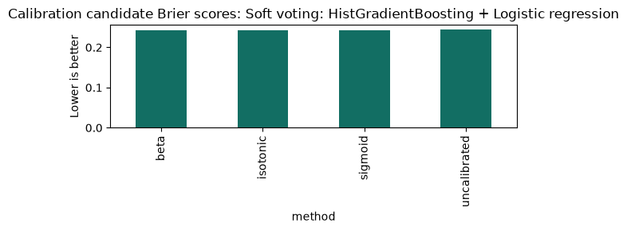

**Sumber:** notebooks/13_probability_calibration.ipynb.  
**Deskripsi:** Bar membandingkan Brier score beta, isotonic, sigmoid, dan uncalibrated pada soft vote historis.  
**Interpretasi:** Nilai berada berdekatan; beta/sigmoid sedikit lebih rendah daripada uncalibrated pada output yang tersimpan.  
**Relevansi:** Menunjukkan besarnya perubahan skor probabilitas historis. Grafik bukan hasil kalibrasi kandidat corrected.

### Gambar 28. Reliability Diagram Holdout Historis

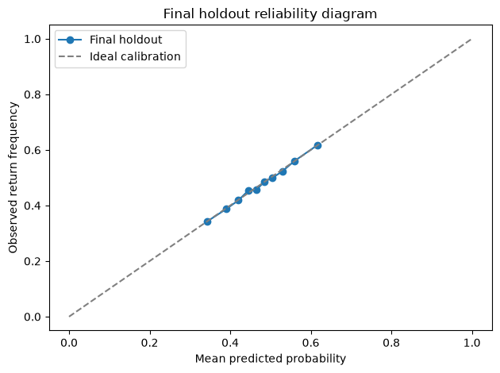

**Sumber:** notebooks/19_final_model_evaluation.ipynb.  
**Deskripsi:** Rata-rata probabilitas per bin kuantil diplot terhadap frekuensi retur aktual; garis putus-putus menunjukkan kalibrasi ideal.  
**Interpretasi:** Titik pada rentang probabilitas yang tampak berada relatif dekat diagonal, dengan selisih kecil pada beberapa bin. Hasil didasarkan pada satu holdout historis dan jumlah bin terbatas.  
**Relevansi:** Membantu memeriksa reliabilitas probabilitas model lama, bukan menjamin kalibrasi masa depan atau LightGBM terkoreksi.

## 10. Feature Importance and Interpretability

### Gambar 23. Permutation Importance pada Validation

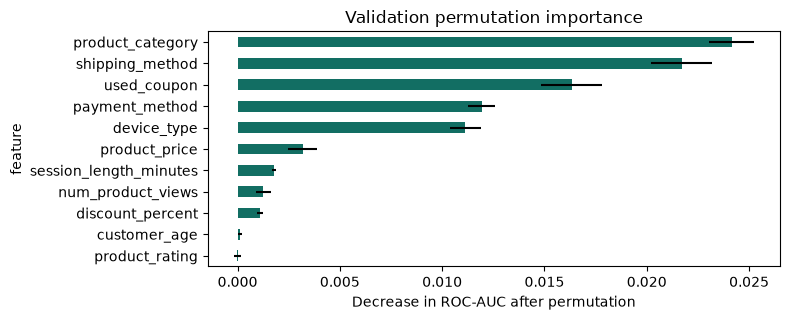

**Sumber:** notebooks/14_explainable_ai.ipynb.  
**Deskripsi:** Penurunan ROC-AUC setelah permutasi fitur, dengan error bars dari pengulangan.  
**Interpretasi:** product_category dan shipping_method memiliki penurunan terbesar pada output ini; coupon/payment/device juga berkontribusi. customer_age dan product_rating berada dekat nol. Ini adalah ketergantungan prediktif pada model/sampel tersebut, bukan pengaruh kausal.  
**Relevansi:** Memberi gambaran fitur yang dipakai model lama. Tidak dihitung ulang untuk kandidat corrected dan tidak disertai analisis kestabilan lintas fold. Tidak ada output gambar SHAP.

## 11. Risk Prioritization and Capacity Simulation

### Gambar 24. Flag Ketidakpastian pada Decision-study Holdout

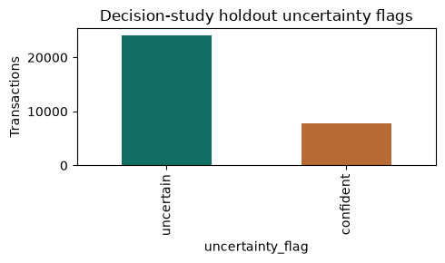

**Sumber:** notebooks/15_uncertainty_analysis.ipynb.  
**Deskripsi:** Jumlah transaksi yang diberi flag uncertain dibanding confident.  
**Interpretasi:** Batang uncertain lebih tinggi pada subset yang ditampilkan. Ini mencerminkan aturan confidence flag di eksperimen, bukan probabilitas error yang telah dikalibrasi.  
**Relevansi:** Menggambarkan volume yang mungkin memerlukan telaah tambahan, tetapi tidak menunjukkan manfaat memasukkan uncertainty ke ranking.

### Gambar 25. Biaya Simulasi Holdout pada Kapasitas 10%

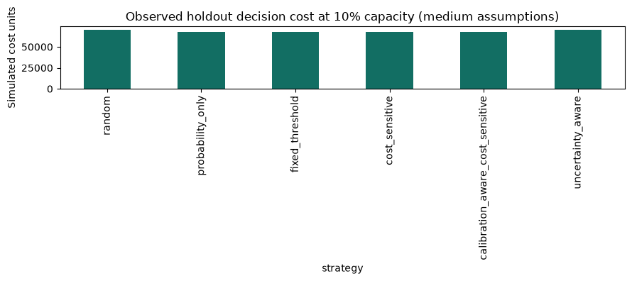

**Sumber:** notebooks/16_cost_sensitive_decision_analysis.ipynb.  
**Deskripsi:** Biaya skenario medium dibandingkan untuk random, probability-only, fixed threshold, cost-sensitive, calibration-aware cost-sensitive, dan uncertainty-aware.  
**Interpretasi:** Strategi berbasis probability dan transformasi biaya tetap menghasilkan ranking/biaya yang dekat; nilai biaya bergantung pada parameter yang diasumsikan.  
**Relevansi:** Menunjukkan hasil simulasi, bukan biaya finansial aktual atau return prevention.

### Gambar 26. Sensitivitas Recall@K terhadap Kapasitas dan Biaya FN

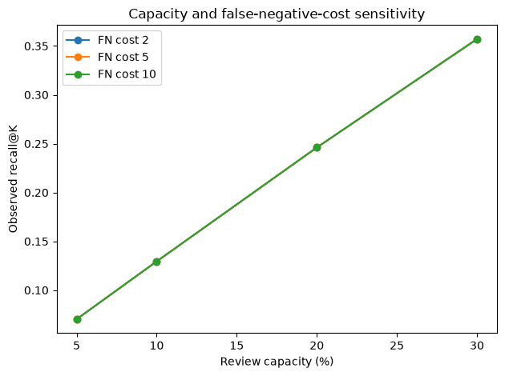

**Sumber:** notebooks/17_adaptive_priority_experiments.ipynb.  
**Deskripsi:** Recall@K diplot pada kapasitas review 5%, 10%, 20%, dan 30% untuk skenario false-negative cost.  
**Interpretasi:** Recall@K meningkat ketika kapasitas naik. Garis skenario terlihat berdekatan/bertumpang tindih pada plot tersimpan; tidak ada kesimpulan bahwa variasi biaya selalu mengubah pilihan secara material.  
**Relevansi:** Menunjukkan trade-off cakupan kasus dan kapasitas dalam data berlabel. Bukan estimasi efek review di operasi.

### Gambar 27. Biaya Ablation pada Kapasitas Review 10%

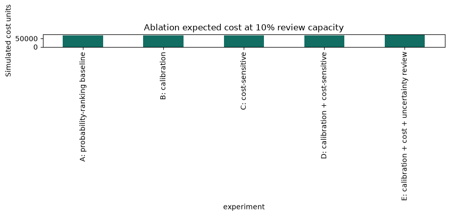

**Sumber:** notebooks/18_novelty_ablation_study.ipynb.  
**Deskripsi:** Biaya simulasi membandingkan baseline probability ranking, calibration, cost-sensitive, kombinasi calibration+cost, dan uncertainty review.  
**Interpretasi:** Empat strategi pertama tampak serupa karena pemetaan biaya tetap mempertahankan urutan; varian uncertainty-aware lebih tinggi pada output ini.  
**Relevansi:** Mendukung batas klaim bahwa tambahan aturan belum menunjukkan pengurangan biaya pada eksperimen tersimpan. Nilai adalah satu skenario, bukan biaya aktual.

## 12. Ringkasan Seluruh Grafik

| No | Judul Grafik | Kategori | Notebook Sumber | File Gambar |
|---:|---|---|---|---|
| 1 | Pemeriksaan Dependensi Environment ReturnWise | Environment | 00 | figures/environment/FIG-001-environment-dependency-check.png |
| 2 | Ukuran Berkas Dataset Kompetisi | Data understanding | 01 | figures/data_understanding/FIG-002-competition-file-sizes.png |
| 3 | Distribusi Target returned | Data understanding | 04 | figures/eda/FIG-003-returned-target-distribution.png |
| 4 | Usia Pelanggan Menurut Status Retur | EDA | 04 | figures/eda/FIG-004-customer-age-by-returned.png |
| 5 | Harga Produk Menurut Status Retur | EDA/kualitas | 04 | figures/eda/FIG-005-product-price-by-returned.png |
| 6 | Persentase Diskon Menurut Status Retur | EDA | 04 | figures/eda/FIG-006-discount-percent-by-returned.png |
| 7 | Rating Produk Menurut Status Retur | EDA | 04 | figures/eda/FIG-007-product-rating-by-returned.png |
| 8 | Proporsi Retur Menurut Jenis Perangkat | EDA | 04 | figures/eda/FIG-008-device-type-return-rate.png |
| 9 | Proporsi Retur Menurut Kategori Produk | EDA | 04 | figures/eda/FIG-009-product-category-return-rate.png |
| 10 | Proporsi Retur Menurut Metode Pengiriman | EDA | 04 | figures/eda/FIG-010-shipping-method-return-rate.png |
| 11 | Proporsi Retur Menurut Metode Pembayaran | EDA | 04 | figures/eda/FIG-011-payment-method-return-rate.png |
| 12 | Ukuran Efek Asosiasi Fitur | Statistik | 05 | figures/eda/FIG-012-feature-association-effect-sizes.png |
| 13 | Korelasi Spearman Antar-Prediktor Numerik | Statistik | 05 | figures/eda/FIG-013-spearman-numeric-correlation.png |
| 14 | P-Value Terkecil Setelah Koreksi BH | Statistik | 06 | figures/eda/FIG-014-bh-adjusted-p-values.png |
| 15 | Ukuran Split Pengembangan dan Holdout | Preprocessing | 07 | figures/preprocessing/FIG-015-stratified-train-holdout-sizes.png |
| 16 | Interaksi Harga dan Diskon | Feature engineering | 08 | figures/feature_engineering/FIG-016-price-times-discount-distribution.png |
| 17 | Tampilan Produk per Menit Sesi | Feature engineering | 08 | figures/feature_engineering/FIG-017-views-per-session-minute-distribution.png |
| 18 | Interaksi Harga dan Rating | Feature engineering | 08 | figures/feature_engineering/FIG-018-price-times-rating-distribution.png |
| 19 | Metrik CV Baseline Awal | Model comparison | 09 | figures/model_comparison/FIG-019-baseline-cv-metrics.png |
| 20 | ROC-AUC Benchmark Model Lanjutan | Model comparison | 10 | figures/model_comparison/FIG-020-advanced-model-cv-roc-auc.png |
| 21 | Kandidat Tunggal dan Blend OOF | Model comparison | 12 | figures/model_comparison/FIG-021-single-models-vs-oof-blends.png |
| 22 | Brier Score Kandidat Kalibrasi | Calibration | 13 | figures/calibration/FIG-022-calibration-candidate-brier-scores.png |
| 23 | Permutation Importance | Explainability | 14 | figures/feature_importance/FIG-023-validation-permutation-importance.png |
| 24 | Flag Ketidakpastian | Prioritization | 15 | figures/prioritization/FIG-024-uncertainty-flags.png |
| 25 | Biaya Simulasi Kapasitas 10% | Prioritization | 16 | figures/prioritization/FIG-025-decision-cost-at-10-percent-capacity.png |
| 26 | Recall@K terhadap Kapasitas dan Biaya FN | Prioritization | 17 | figures/prioritization/FIG-026-capacity-and-fn-cost-sensitivity.png |
| 27 | Biaya Ablation Kapasitas 10% | Prioritization | 18 | figures/prioritization/FIG-027-ablation-cost-at-10-percent-capacity.png |
| 28 | Reliability Diagram Holdout Historis | Calibration/evaluation | 19 | figures/model_evaluation/FIG-028-historical-holdout-reliability-diagram.png |
| 29 | Ringkasan Metrik Holdout Historis | Model evaluation | 20 | figures/model_evaluation/FIG-029-historical-holdout-metric-summary.png |

### Jumlah menurut kategori

| Kategori | Jumlah |
|---|---:|
| Environment | 1 |
| Data understanding | 2 |
| EDA dan statistik | 11 |
| Preprocessing | 1 |
| Feature engineering | 3 |
| Feature selection | 0 |
| Model comparison | 3 |
| Calibration | 2 (kandidat Brier dan reliability diagram) |
| Feature importance | 1 |
| Prioritization dan capacity simulation | 4 |
| Model evaluation | 1 ringkasan metrik |
| **Total** | **29** |

**Hasil ekstraksi:** 29 gambar ditemukan, 29 berhasil diekstrak, 0 gambar embedded gagal diekstrak. Grafik baru tidak dibuat dan isi gambar tidak diubah.
