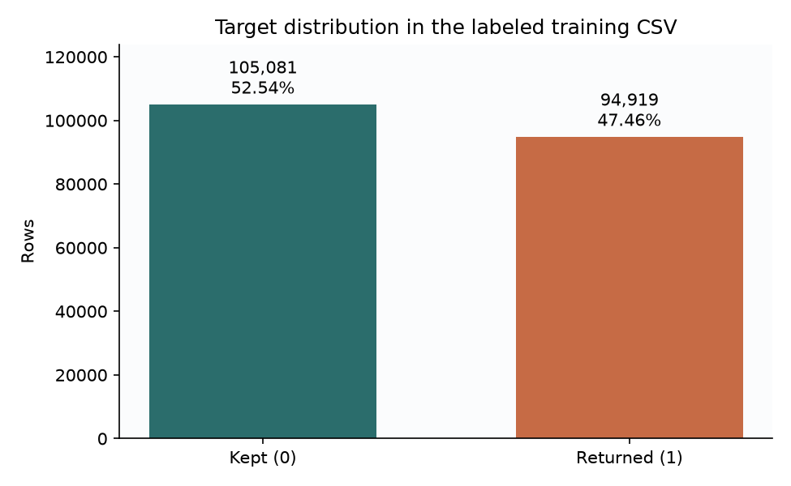
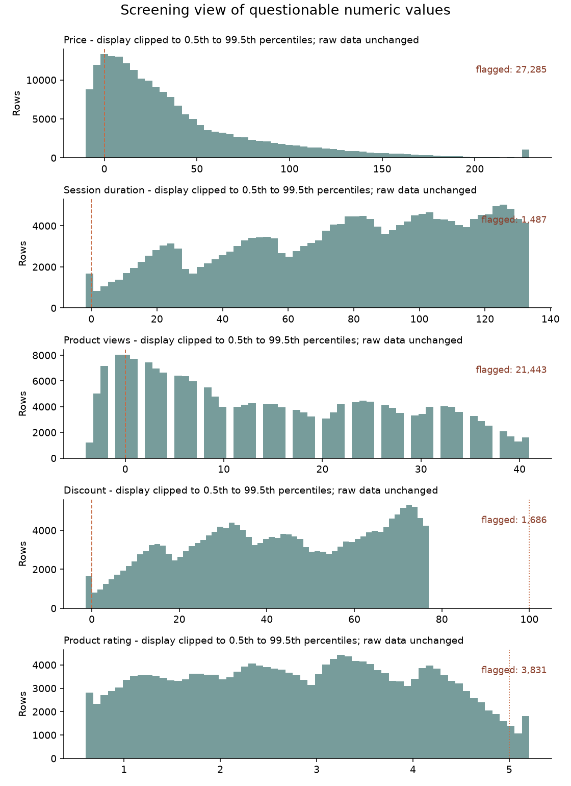
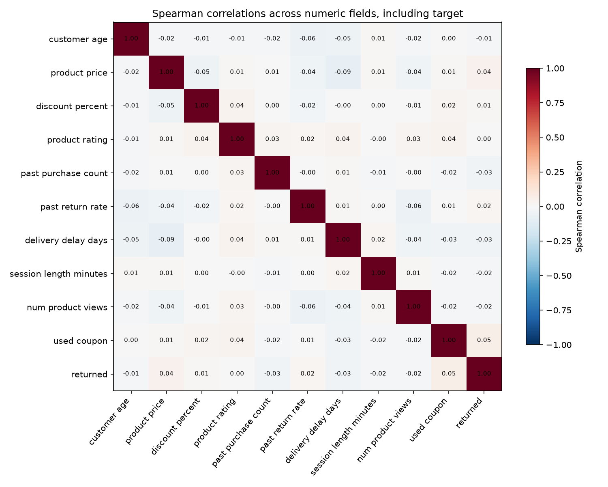
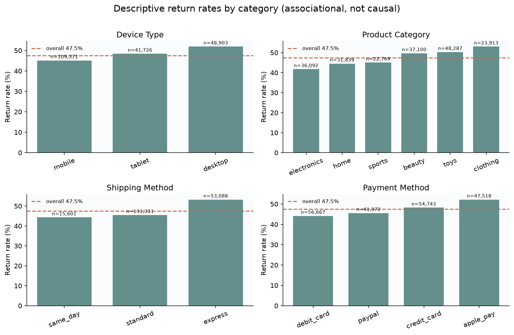

# ReturnWise Dataset Deep Analysis

Analysis date: 2026-11-15  
Data: local Kaggle competition cache, fingerprint `2ae5e87906198d2e3688c12bd807b33194115aea579aacccd070a97732539f56`.

## 1. Data sources and integrity

The active labeled CSV has 200,000 rows and 16 columns; the competition test CSV has 50,000 rows and 15 feature columns; the sample submission has 50,000 rows. The test CSV contains no `returned` label. Train and test feature names and order match after removing the training target. The target is binary with no missing values or unexpected class values.

Local SHA-256 hashes, file sizes, complete streaming parse counts, and competition listing sizes are recorded in `data/kaggle/dataset_metadata.json`. The CSV files were independently checked and match the local acquisition record. The cached 1 MiB ZIP is an incomplete `BadZipFile` with a resume marker; it was not extracted. The verified CSV files, rather than the incomplete ZIP, were used for this analysis.

## 2. Target and row structure

| Target | Rows | Share |
|---|---:|---:|
| Kept (`returned=0`) | 105,081 | 52.5405% |
| Returned (`returned=1`) | 94,919 | 47.4595% |

There are no missing cells and no exact duplicate rows in the labeled CSV. `order_id` is unique within train and within test, with no overlap between the two files. Training IDs span 0-249,999 and are not sorted in row order; test IDs span 4-249,997. The training ID-target Pearson and Spearman correlations are both about -0.002. This is not evidence of a usable timestamp or chronological ordering.

The test covariate marginals are close to train in this file. The largest standardized mean difference among numeric features, calculated from the two file means and pooled standard deviations, is approximately 0.0065 (customer age). The largest inspected categorical proportion difference is about 0.0045 (desktop share). This is a descriptive comparison, not a formal drift test and not a guarantee that future production data will match.

## 3. Feature dictionary and raw numeric distribution

| Feature | Type / distinct values | Min | 1st pct | Median | 99th pct | Max | Spearman with target |
|---|---|---:|---:|---:|---:|---:|---:|
| `customer_age` | numeric / 78 | 10 | 17 | 58 | 85 | 87 | -0.011 |
| `product_price` | numeric / 199,800 | -183.29 | -9.17 | 24.46 | 189.26 | 855.08 | 0.040 |
| `discount_percent` | numeric / 199,907 | -7.54 | 0.54 | 42.95 | 76.56 | 78.79 | 0.011 |
| `product_rating` | numeric / 199,936 | 0.445 | 0.649 | 2.819 | 5.115 | 5.453 | 0.004 |
| `past_purchase_count` | numeric / 26 | 1 | 5 | 9 | 23 | 26 | -0.032 |
| `past_return_rate` | numeric / 199,934 | -0.061 | -0.002 | 0.191 | 0.632 | 0.866 | 0.019 |
| `delivery_delay_days` | numeric / 199,947 | -9.05 | -5.45 | 0.519 | 6.675 | 7.961 | -0.033 |
| `session_length_minutes` | numeric / 199,921 | -11.01 | 1.57 | 81.56 | 132.68 | 137.65 | -0.018 |
| `num_product_views` | integer / 50 | -5 | -3 | 13 | 40 | 44 | -0.020 |
| `used_coupon` | binary / 2 | 0 | 0 | 1 | 1 | 1 | 0.055 |
| `order_id` | identifier / 200,000 | 0 | 2,491 | 124,891 | 247,487 | 249,999 | -0.002 |

All 4 categorical columns are low-cardinality and have a small set of populated levels: `device_type` (3), `product_category` (6), `shipping_method` (3), and `payment_method` (4). There is no rare-category or high-cardinality categorical problem in the observed file. Numeric distinct counts mostly reflect continuous values, not categorical codes.

## 4. Questionable values and target association

The ranges below are **screening rules**, not data-cleaning rules. The competition description gives conventional units, but the dataset does not document a special encoding or an error-correction process for these values. Do not silently clip, delete, or replace them.

| Field | Screening rule | Flagged rows | Share | Return rate among flagged | Return rate otherwise |
|---|---|---:|---:|---:|---:|
| `product_price` | price below 0 | 27,285 | 13.64% | 43.77% | 48.04% |
| `session_length_minutes` | duration below 0 | 1,487 | 0.74% | 51.51% | 47.43% |
| `num_product_views` | count below 0 | 21,443 | 10.72% | 50.69% | 47.07% |
| `discount_percent` | outside 0-100 | 1,686 | 0.84% | 41.52% | 47.51% |
| `product_rating` | outside common 0-5 range | 3,831 | 1.92% | 47.61% | 47.46% |
| `past_return_rate` | outside 0-1 | 2,220 | 1.11% | 42.21% | 47.52% |

The conditional return rates are descriptive and do not establish that flagged values have a special meaning. Several flags have different observed rates, so simply deleting or clipping them could remove predictive signal or change the data-generating pattern. Their provenance must be resolved, then raw, explicitly flagged, and robustly transformed alternatives can be compared inside the training pipeline.

An IQR screen at 1.5 times the interquartile range also flags `past_purchase_count` (23,432 rows), `product_price` (11,689), `delivery_delay_days` (9,053), and `past_return_rate` (7,260). These are screening counts only; no outlier rows were dropped.

## 5. Categorical levels and observed return rates

| Feature | Level | Rows | Return rate |
|---|---|---:|---:|
| Device | mobile | 109,371 | 45.12% |
| Device | desktop | 48,903 | 51.91% |
| Device | tablet | 41,726 | 48.38% |
| Product category | electronics | 36,092 | 41.73% |
| Product category | home | 31,839 | 44.54% |
| Product category | sports | 22,769 | 45.04% |
| Product category | beauty | 37,100 | 49.72% |
| Product category | toys | 48,287 | 50.31% |
| Product category | clothing | 23,913 | 53.05% |
| Shipping | same day | 15,601 | 44.29% |
| Shipping | standard | 131,311 | 45.51% |
| Shipping | express | 53,088 | 53.22% |
| Payment | debit card | 56,667 | 44.18% |
| Payment | PayPal | 41,072 | 45.54% |
| Payment | credit card | 54,743 | 48.21% |
| Payment | Apple Pay | 47,518 | 52.17% |

These are unadjusted associations. They may reflect confounding or competition-data construction and are not evidence that changing a category or payment method causes returns.

## 6. Figures

All plots use the actual labeled CSV. The numeric screening plot clips only the *display* to the 0.5th-99.5th percentile range so the central distribution remains visible; the raw values and all analysis counts remain unchanged.

Spearman correlations between raw numeric fields and the label are small in magnitude (largest absolute value among the listed raw numeric fields is about 0.055 for `used_coupon`). The categorical group rates show larger differences, but they remain unadjusted and should be checked with fold-based model comparisons rather than promoted directly into rules.

## 7. Feature availability and leakage matrix

The competition descriptions define field meanings but provide no row-level event timestamps, capture timestamps, snapshot rules, or historical aggregate cutoffs. “Candidate” below means plausible from the field name/description; it is not a verified production availability guarantee. The official [data page](https://www.kaggle.com/competitions/retail-return-risk-modeling/data) defines delivery delay using actual delivery and describes purchase/return history as historical values.

| Feature | Available time (evidence in supplied data) | Leakage risk | Decision |
|---|---|---|---|
| `customer_age` | Likely order/account time; no account snapshot date | Low-to-medium if age was refreshed after order | Candidate; verify timestamp semantics |
| `product_price` | Described as price at purchase | Medium if the value is a later catalog price rather than order-line snapshot | Candidate; use immutable transaction value if available |
| `discount_percent` | Likely checkout/order time | Medium if recomputed from a later price or promotion table | Candidate; verify transaction snapshot |
| `product_rating` | Average rating; no snapshot/as-of period | Medium-to-high because a current average can include later ratings | Exclude from strict scenario until snapshot is proven |
| `past_purchase_count` | Purported historical aggregate; no cutoff | High if count includes the current or future orders | Exclude until rebuilt as-of order time |
| `past_return_rate` | Purported historical aggregate; no cutoff or denominator | High if it includes the current outcome or later returns | Exclude until rebuilt from prior resolved orders only |
| `delivery_delay_days` | Requires actual delivery relative to estimate | Direct post-shipment leakage for a pre-shipment prediction | Exclude from operational pre-shipment scenario; diagnostic only |
| `session_length_minutes` | Likely session telemetry, but session end time absent | Medium if duration includes activity after the prediction/action point | Candidate only if session cutoff precedes order decision |
| `num_product_views` | Likely session telemetry; event order absent | Medium if views after checkout or post-decision are included | Candidate only with event cutoff |
| `device_type` | Likely known during session/order | Low-to-medium; point-in-time capture absent | Candidate; verify |
| `product_category` | Known for selected product at purchase | Low if taken from the ordered item; can drift if catalog data is joined later | Candidate; preserve order-line value |
| `shipping_method` | Selected at checkout | Low for pre-shipment after selection; unavailable before the choice | Candidate only after checkout and before shipment |
| `payment_method` | Used at checkout/payment | Low after payment selection; unavailable before selection | Candidate only after checkout |
| `used_coupon` | Applied at checkout | Low after coupon application; unavailable before selection | Candidate only after checkout |
| `returned` | Observed after purchase and return window | Direct target leakage | Label only; never a feature |
| `order_id` | Assigned around order creation; semantics otherwise undocumented | Medium as a potential sequence/proxy or memorization feature | Exclude; no supported timestamp interpretation |

## 8. Experiment scenarios

The previous 11-column model should be labeled **expanded pre-shipment candidate**, because it includes plausible order-time fields but the CSV cannot verify their capture times.

| Scenario | Candidate contents | Status and interpretation |
|---|---|---|
| A. Strict verified pre-shipment | None can be certified solely from the supplied CSV metadata. A smaller source-verified set may be defined if the data owner provides point-in-time rules. | Not yet implementable as a verified temporal scenario. Do not report it as measured. |
| B. Expanded pre-shipment candidate | Current 11 fields: customer age, price, discount, rating, session length, views, device, product category, shipping method, payment method, coupon. | Existing saved model scenario; conditional on order-time availability and snapshots. Treat as sensitivity research, not deployment validation. |
| C. Diagnostic all-available-fields | Scenario B plus delivery delay, past purchase count, and past return rate; keep `returned` out and keep `order_id` excluded. | Not run as a combined predictive comparison in the saved project. If run, label diagnostic only and never equate its metrics to A or B. |

No temporal validation is possible until a usable event timestamp is supplied. The competition overview states that the records span 2022-2024, but a period description alone is not an observation-level time variable.

## 9. Preprocessing decision record

For the saved benchmark, raw rows were preserved. The pipeline applies median imputation to numeric values, most-frequent imputation and one-hot encoding to most categorical values, and three deterministic interactions: price x discount, product views / session minutes, and price x rating. Infinite engineered values are converted to missing for the numeric imputer. No clipping, outlier deletion, log transformation, robust scaling comparison, anomaly indicators, or raw-vs-cleaned scenario comparison was completed.

This preserves provenance but does not resolve invalid values. The next defensible comparison is to keep the raw pipeline as the baseline and test separately: (1) explicit invalid-value indicators with values retained, (2) robust scaling or monotonic transforms appropriate to price/session distributions, and (3) source-owner-approved corrections. Each transformation must be fitted inside CV and compared on the same folds.

## 10. Conclusions and limitations

The labeled data are complete and the class balance is suitable for stratified binary-classification experiments. Categorical features are low-cardinality. Train/test feature marginals look close, and there is no obvious schema mismatch or target inconsistency.

The main dataset issues are semantic rather than missingness: a substantial fraction of prices and product-view counts are negative, and several other fields have values outside conventional ranges. The cause is unknown. The dataset lacks timestamps and point-in-time lineage, so the existing pre-shipment claim is a modeling scenario based on plausible feature meaning, not a verified operational snapshot. Historical aggregates and delivery delay remain excluded from the current artifact.

The small raw numeric correlations and modest saved ROC-AUC (0.5895) show limited one-variable signal and modest overall discrimination, respectively. They do not imply that feature engineering cannot help, but any gains must be shown on training-side CV and a single untouched holdout. No test.csv performance can be calculated because it has no label.
